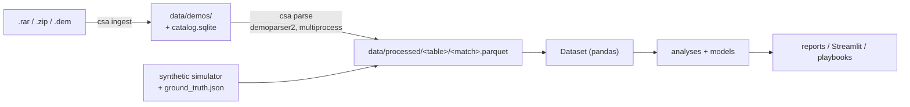

# csanalysis: machine learning on CS2 pro demos

Import professional Counter-Strike 2 demos, turn them into clean analytical tables, and use statistics and
machine learning to answer questions players care about:

- Which bombsites favor which side on each map, and how do post-plants and retakes play out?
- Which positions win more duels than the weapons and HP involved would predict?
- Which smokes actually change the round win probability, and how do you throw them (`setpos`/`setang`)?
- How should you play, buy, force or save when you don't have money for a full buy?

The goal is a **per-map, per-side playbook** you can read and practice from, built on evidence rather than folklore.

> **Status:** phase 1 of 4 is done: ingestion, parsing, storage, and a synthetic ground-truth generator.
> The analyses, dashboard and playbooks follow. See the [roadmap](#roadmap).

## Quickstart

```bash
uv sync                                   # Python 3.12, installs everything
uv run csa ingest ~/Downloads/hltv/       # .dem, .rar, .zip, .7z, .dem.gz (deduplicated)
uv run csa parse                          # parallel parsing into data/processed/
uv run csa info                           # what's in the dataset
uv run csa inspect-demo match.dem         # sanity report for a single demo
```

No demos yet? Generate synthetic matches with known ground truth:

```bash
uv run csa synth -n 200 -d data/synthetic
uv run csa info -d data/synthetic
```

### Getting demos

Every match page on [HLTV](https://www.hltv.org/results) has a **GOTV Demo** download (a `.rar` with one `.dem`
per map). Download them manually and point `csa ingest` at the folder. Extracting `.rar` needs `7z` (p7zip) or
`bsdtar`. The project deliberately does not scrape HLTV.

For results you can trust, aim for 100+ matches per map. Your own FACEIT or matchmaking demos work too, which is
how personal comparison reports will work later.

## Architecture



| Module | Responsibility |
|---|---|
| `ingest.py` | Extracts archives safely (path-traversal-proof), deduplicates by SHA-256, tracks status in SQLite |
| `parsing/parser.py` | Turns one demo into nine tables with [demoparser2](https://github.com/LaihoE/demoparser) (Rust) |
| `parsing/rounds.py` | Pure functions for round boundaries, team identity and scores that survive warmups, knife rounds, restarts and backup restores |
| `schema.py` | The single data contract: column types, nullability, keys and validation ([docs](docs/data_schema.md)) |
| `storage.py` | Partitioned Parquet (one file per match per table) with atomic writes and a lazy `Dataset` loader |
| `synthetic.py` | Match simulator with **planted effects** used to validate the analyses |
| `pipeline.py` / `cli.py` | Parallel, resumable parsing and the `csa` command |

### Tables

`matches`, `rounds`, `kills`, `damages`, `grenades` (with throw position and view angles, so lineups are
reproducible), `blinds`, `bomb`, `economy` (per player, per round) and `snapshots` (every player's position, HP and
weapon every 2 seconds). Full column reference: [docs/data_schema.md](docs/data_schema.md).

## Validating the methods with synthetic ground truth

Observational esports data is heavily confounded. Full-buy teams also carry the utility, and post-plant smokes
are thrown by teams that are already winning. A naive "win rate when smoke X was thrown" mostly measures economy.

To keep the analyses honest, `csa synth` simulates matches duel by duel with realistic economy rules and
**planted** effects, all written to `ground_truth.json`:

- a duel advantage for each position
- a win-probability effect for each smoke
- site difficulty
- the value of armor on eco rounds
- a penalty for shooting while moving

Every analysis is unit-tested on whether it recovers those effects, including under the same economic
confounding real games have, before it is ever run on pro data.

## Development

```bash
uv run pytest                          # unit + synthetic integration tests
CSA_TEST_DEMO=path/to/demo.dem uv run pytest   # also run the real-demo parser test
uv run ruff check src tests
```

## Roadmap

1. **Foundation** ✅: ingestion, parsing, schema, storage, synthetic data
2. **Core analyses**: site win rates, duel positions (positional advantage over a weapon/HP baseline model), smoke
   impact (causal adjustment for economy), low-buy strategy and force-vs-save, a live round win-probability model
3. **Extended analyses**: opening duels, trading and spacing, utility effectiveness, post-plant and retake
   positions, CT setups, T timings, man-advantage conversion, clutches, pistol rounds, weapon and movement value
4. **Product**: per-map playbooks with lineups to practice, a Streamlit dashboard, personal coach reports from your
   own demos
